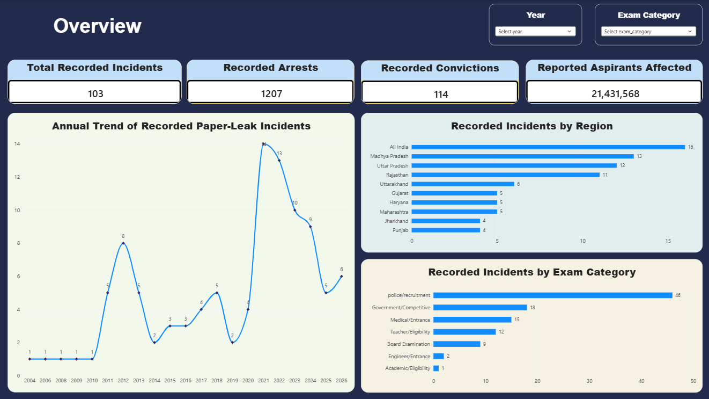
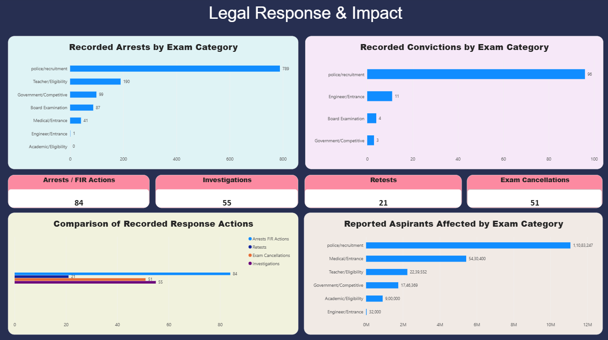
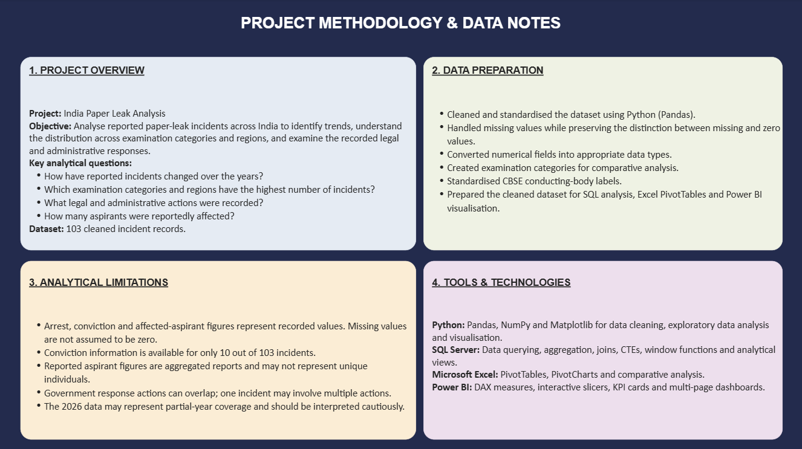

# India Paper Leak Analysis

An end-to-end data analytics project investigating reported paper leak incidents across India using **Python, SQL Server, Microsoft Excel and Power BI**.

## Project Overview

Paper leaks undermine the integrity of competitive examinations and affect students and job aspirants across India. This project analyses reported incidents to identify patterns over time, examine the distribution of incidents across examination categories and regions, and understand the recorded legal and administrative responses.

The analysis covers **103 cleaned incident records** and explores the scale of reported impact on aspirants.

## Project Objectives

- Analyse trends in reported paper leak incidents over the years.
- Identify examination categories and regions with the highest number of incidents.
- Examine recorded arrests and convictions.
- Analyse government responses, including investigations, exam cancellations and retests.
- Explore the reported number of aspirants affected across examination categories.

## Tools & Technologies

| Tool | Application |
|---|---|
| Python | Data cleaning, exploratory data analysis and visualisation |
| Pandas & NumPy | Data manipulation and numerical analysis |
| Matplotlib | Data visualisation |
| SQL Server | Data querying, aggregation, CTEs, window functions and views |
| Microsoft Excel | PivotTables, PivotCharts and comparative analysis |
| Power BI | Interactive dashboards, DAX measures, KPI cards and slicers |

## Key Findings

The analysis of 103 cleaned incident records revealed the following patterns:

1. **Incident trends:** 2021 recorded the highest number of incidents (14), followed by 2022 (13).

2. **Examination categories:** Police and recruitment examinations accounted for 46 incidents, representing approximately 44.7% of the dataset.

3. **Regional distribution:** The highest recorded area counts were All India (16), Madhya Pradesh (13), Uttar Pradesh (12) and Rajasthan (11).

4. **Recorded arrests:** A total of 1,207 arrests were recorded. Police and recruitment examinations accounted for 789, approximately 65.4% of the recorded total.

5. **Recorded convictions:** The dataset contained 114 recorded convictions, but conviction information was available for only 10 of the 103 incidents.

6. **Administrative response:** Arrest/FIR actions were recorded for 84 incidents, investigations for 55, exam cancellations for 51 and retests for 21. These actions can overlap.

7. **Reported impact:** The dataset contained approximately 21.43 million reported affected-aspirant entries. These figures may include overlapping reports and should not be interpreted as unique individuals.


## Power BI Dashboard

The interactive dashboard is organised into three pages.

### 1. Executive Overview

Provides a high-level summary of incidents, annual trends, regional distribution and examination categories.


### 2. Legal Response & Impact

Examines recorded arrests, convictions, government response actions and reported aspirants affected by examination category.


### 3. Methodology & Data Notes

Documents the project objectives, data preparation steps, analytical limitations and technologies used.


## Project Structure

```text
india-paper-leak-analysis/
│
├── data/
│   ├── paper_leaks.csv
│   └── paper_leaks_cleaned.csv
│
├── notebooks/
│   ├── preliminary_eda.ipynb
│   └── EDA-2.ipynb
│
├── sql/
│   └── paper_leak_analysis.sql
│
├── excel/
│   └── paper_leak_analysis.xlsx
│
├── powerbi/
│   └── India_Paper_Leak_Analysis.pbix
│
├── screenshots/
│   ├── executive_overview.png
│   ├── legal_response_impact.png
│   └── methodology_notes.png
│
└── README.md
```

## Analytical Considerations & Limitations

- Missing values are not treated as confirmed zeroes.
- Conviction information is available for only 10 out of 103 incidents.
- Arrest, conviction and affected-aspirant figures represent recorded values in the dataset.
- Reported aspirant figures are aggregated reports and may not represent unique individuals.
- Government response actions can overlap; an incident may involve multiple actions.
- The 2026 data may represent partial-year coverage and should be interpreted cautiously.

## Project Workflow

1. Data cleaning and exploratory analysis using Python.
2. Analytical querying and aggregation using SQL Server.
3. Comparative analysis using Microsoft Excel PivotTables and PivotCharts.
4. Interactive dashboard development using Power BI.


